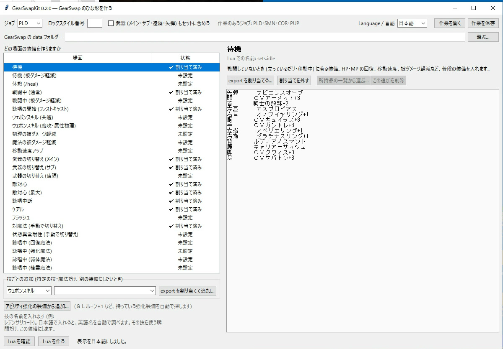
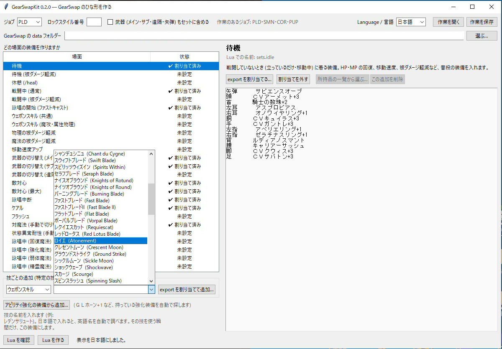
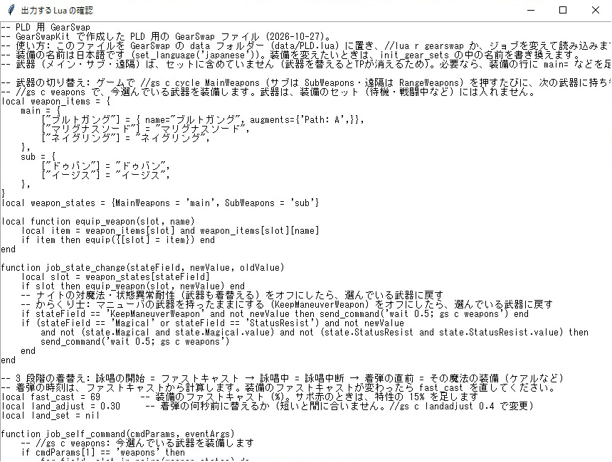
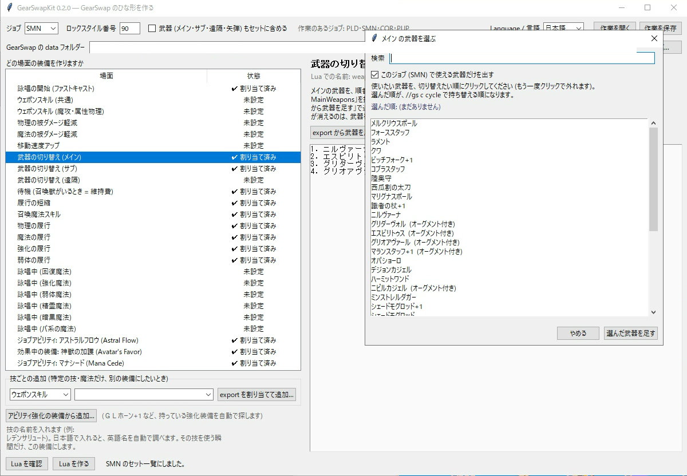
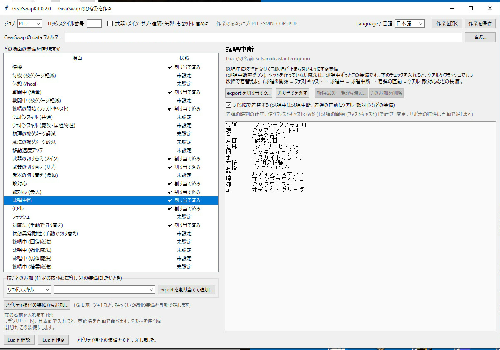
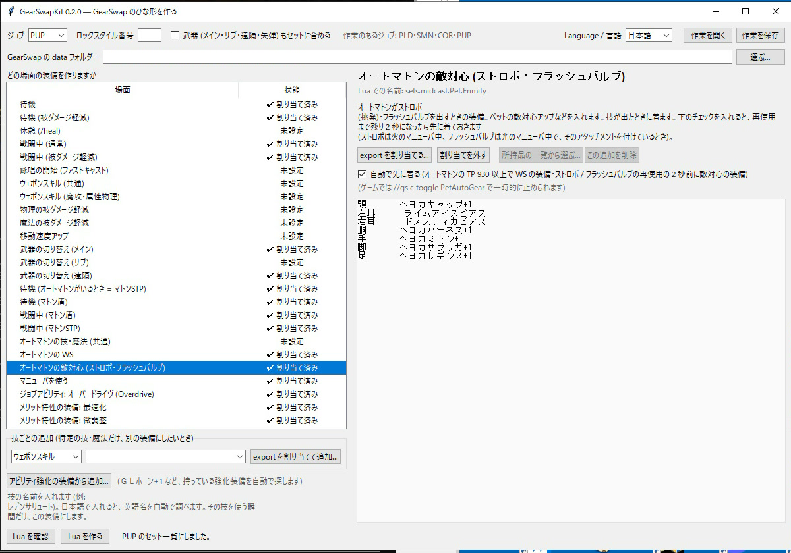
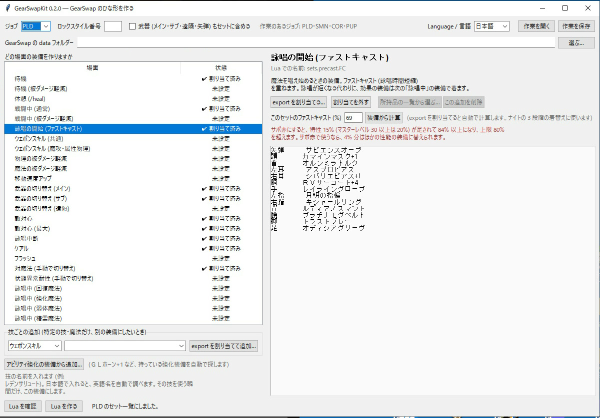
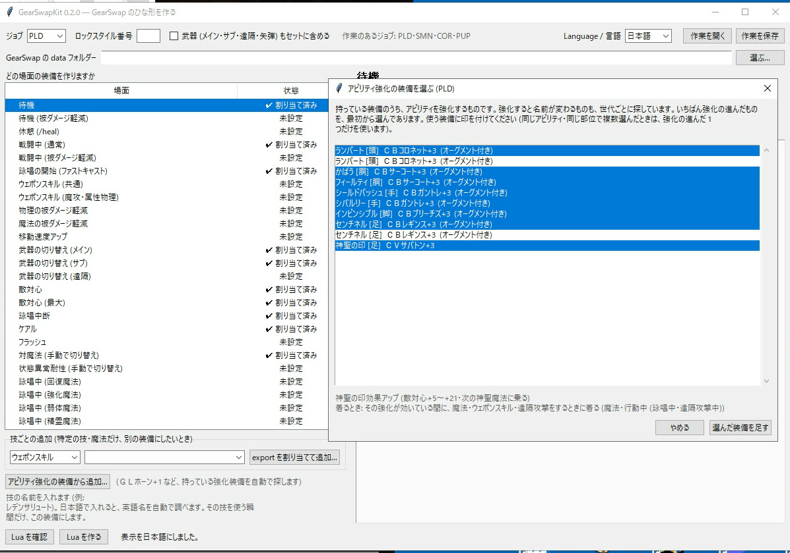

# GearSwapKit

FF11 の GearSwap を、**自分で Lua を書かずに始める**ための、日本語のキットです。
ゲームで「この装備を着たとき」の装備を書き出して (`//gs export`)、キットで「どの場面の装備にするか」を選ぶと、GearSwap のジョブ用の Lua ファイルができます。

> English summary: a small tool that turns the gear files written by `//gs export` into a ready-to-use GearSwap job Lua (Mote-Include based). No optimization, no game automation. The interface is available in English or Japanese; this repository is the Japanese edition, and the English one lives at [GearSwapKit-EN](https://github.com/hikaruoshino/GearSwapKit-EN).

---

## 先にお読みください

- **FF11 の利用規約は、サードパーティ製ツールを禁止しています。** Windower や GearSwap も、その対象になりえます。アカウントの停止などの不利益を受ける可能性があり、作者は責任を負いません。**自己責任でお使いください。**
- このキットは、**ゲームを操作せず、メモリも読み書きしません。** 読むのは、あなたが自分で書き出した `//gs export` のファイルと、Windower の `res` フォルダー (技の名前を調べるため) だけです。書き出すのは、GearSwap 用の Lua ファイル 1 つと、作業の保存ファイルです。
- キットは、**装備の最適化をしません。** 「どの装備が一番強いか」は計算しません。あなたが着た装備を、そのまま、選んだ場面のセットにします。
- できあがった Lua は、**出発点**です。動きを理解して、少しずつ直していく前提で作っています。

## できること

- ジョブを選び、**場面の一覧** (待機・戦闘中・詠唱の開始・ウェポンスキルなど) から、装備を入れたい場面を選びます。場面ごとに、**何のための装備か**を、ヘルプで説明します。
- `//gs export` で書き出したファイルを渡すだけで、その場面の装備が入ります。
- **技ごとの追加**: ウェポンスキル・アビリティ・魔法・ペットの技・受ける強化を、**ドロップダウンから選んで**、export の装備を割り当てます。
- **アビリティ強化の装備**: ＧＬホーン+1 のような装備を、持っているものの中から**自動で探して**入れます (全 22 ジョブ)。
- **武器の切り替え**: `//gs c cycle MainWeapons` などで、選んだ順に武器を持ち替えます。
- **ロックスタイル**: 読み込んだあと、指定した番号の装備セットで、見た目を固定します。
- **ジョブごとの仕組み**: 狩人・コルセアの矢弾の使い分け、ナイトの 3 段階の着替え、からくり士・召喚士・獣使いのペットの技の装備、学者の腰の自動選択など (下の「ジョブごとの仕組み」)。
- **作業の保存**: 閉じるときに自動で保存し、次に起動したときに自動で開きます。「作業を保存」「作業を開く」もあります。
- **既存のファイルを守ります**: 同じ名前の Lua があれば、同じ場所にバックアップを作ってから、上書きします。

## 入れ方・起動

次のどちらかで、起動します。

- **EXE 版** (配布版): `GearSwapKit.exe` をダブルクリックします。インストールは要りません。
- **Python 版**: Python 3 (tkinter が使えるもの) で、`python app.py` を実行します。

最初の起動で、画面の言語を選びます (あとで上の「Language / 言語」で変えられます)。

## 使い方

1. **ゲームで装備を着ます。** 作りたい場面の装備 (例: 待機のときの装備) を、全部着た状態にします。
2. ゲームのチャットで、`//gs export` を実行します。
   - 装備中のセットが、`Windower4/addons/gearswap/data/export/` の中に、「キャラ名 日付 時刻.lua」というファイルとして書き出されます。
   - 場面ごとに、装備を着替えて、同じことを繰り返します (待機・戦闘・詠唱など)。
   - 書き出したファイルは、**名前を変えても使えます** (日本語の名前にしても読み込めます。例: 「召喚士の待機セット.lua」)。キットは、ファイルの名前ではなく、中身を読みます。
3. キットを起動し、**ジョブ**を選びます。
4. 上の「**GearSwap の data フォルダー**」を、選びます。例: `…/Windower4/addons/gearswap/data` (次からは覚えています)。
   - 同じ Windower の `res` フォルダーを、自動で探します (日本語の技名を英語名に直すために使います)。
5. 左の一覧から、場面を選びます。右に、その場面の説明が出ます。
6. 「**export を割り当てる…**」を押して、その場面に使う `//gs export` のファイルを選びます。
   - 「所持品の一覧」のファイルを選ぶと、断られます。**着ている装備のセット**を書き出したファイルを選んでください。
7. 特定の技だけ、別の装備にしたいときは、左下の「**技ごとの追加**」で種類を選び、ドロップダウンから技を選んで (名前を打って探すこともできます)、「**export を割り当てて追加…**」を押します。ファイルを選ぶと、左の一覧に、その技のセットが出ます。
   - ウェポンスキルは、ジョブが使える武器の種類で絞っています。ミシック・エルゴンなどジョブ専用の WS は、そのジョブだけに出ます。

8. 「**Lua を確認**」で、出力の中身を見られます。

9. 「**Lua を作る**」を押すと、`data/<ジョブ>.lua` ができます。
10. ゲームで、`//gs reload` (または `//lua r gearswap`) を実行するか、ジョブを変えて、読み込みます。**Lua を作り直したら、読み込み直すまでゲームには反映されません。**

## 場面の一覧の意味 (主なもの)

| 場面 | いつ着る装備か |
|---|---|
| 待機 (`sets.idle`) | 戦闘していないとき (立っている・移動中) |
| 待機 (被ダメージ軽減) (`sets.idle.DT`) | `//gs c cycle IdleMode` で DT にしたときの待機 |
| 休憩 (`sets.resting`) | `/heal` で座っているとき |
| 戦闘中 (`sets.engaged`) | 敵と戦っているとき |
| 戦闘中 (被ダメージ軽減) (`sets.engaged.DT`) | `//gs c cycle HybridMode` で DT にしたときの戦闘中 (カット) |
| 詠唱の開始 (`sets.precast.FC`) | 魔法を唱え始めるとき (ファストキャスト) |
| ウェポンスキル (共通) (`sets.precast.WS`) | ウェポンスキルを使う瞬間 |
| ウェポンスキル (魔攻・属性物理) (`sets.precast.WS.Magic`) | サンギンブレード・イオリアンエッジなど、魔法属性の WS |
| ウェポンスキル (クリティカル) (`sets.precast.WS.Critical`) | エヴィサレーション・ボーパルブレード・ランページ・迅など、クリティカルで威力が変わる WS |
| ウェポンスキル (遠隔・物理) (`sets.precast.WS.Range`) | 弓術・射撃の物理の WS (狩人・コルセア・侍) |
| ウェポンスキル (遠隔魔攻) (`sets.precast.WS.RangeMagic`) | レデンサリュート・ワイルドファイアなど (狩人・コルセア。作らなければ魔攻のセット) |
| 物理・魔法の被ダメージ軽減 | `//gs c` の防御モードを切り替えたとき、上に重ねる |
| 移動速度アップ (`sets.Kiting`) | 移動を速くしたいとき |
| 詠唱中 (回復・強化・弱体・精霊・暗黒 など) | 魔法を唱えている間 (魔法のジョブ) |
| 詠唱中 (バ系の魔法) (`sets.midcast.BarElement`) | バファイアなど。強化魔法の装備に重ねる |
| ケアル・ケアルガ・カーズナ・リジェネ・リフレシュ・プロテス・シェル・バ状態異常・ドレイン・アブゾ・陣・計略 など | その系統の魔法を唱えている間 (使えるジョブだけ。詠唱の開始 (ケアル) もあります) |
| 詠唱中 (強化魔法・ほかの人へ) (`sets.midcast['強化魔法'].Other`) | ほかの人に強化魔法をかけるとき (学者・赤魔道士・白魔道士) |
| 弱体魔法 (INT 系・MND 系) | スリプル・ブレイクなど INT が効く弱体と、サイレス・スロウなど MND が効く弱体を分ける (赤魔道士・白魔道士) |
| 遠隔の構え・遠隔攻撃 (STP / 飛命) (`sets.precast.RA`・`sets.RA_STP`・`sets.RA_ACC`) | スナップショット・遠隔攻撃 (狩人・コルセア・侍) |
| トレジャーハンター (`sets.TreasureHunter`) | `//gs c toggle TreasureHunter` でオンにしたとき、戦闘中に重ねる (全ジョブ) |
| 二刀流 (サポ忍・サポ踊) (`sets.engaged.dual11`・`dual21`) | サポジョブを見て、戦闘中に自動で重ねる |
| 睡眠から起きる装備 (`sets.Sleep`) | 睡眠になったら自動で着て、スリップ (HP が減る効果) で起きる。起きたら元の武器に戻す (全ジョブ) |
| 被カーズナ・死の宣告 (`sets.midcast.IncreasedCursna`) | カーズナを受けるとき・聖水を使うとき・死の宣告にかかっている間 (全ジョブ) |
| HP が少ないとき (`sets.LowHp`)・ノックバック防止 (`sets.KnockBack`) | HP 30% 以下で重ねる・`//gs c toggle KnockBack` で重ねる (ナイト・魔導剣士) |

### モードの切り替え

| モード | 選択肢 (セットを作ったものだけ) | 使うセット |
|---|---|---|
| `//gs c cycle IdleMode` | DT・Refresh (リフレシュ) | `sets.idle.DT`・`sets.idle.Refresh` |
| `//gs c cycle OffenseMode` | Acc (命中重視)・SubtleBlow (モクシャ)・Parry (受け流し・踊り子)・Enn (エンスペル・赤魔道士) | `sets.engaged.Acc` など |
| `//gs c cycle HybridMode` | DT | `sets.engaged.DT` |
| `//gs c cycle CastingMode` | MB (マジックバースト)・Acc (魔命重視) (黒赤学風) | `sets.midcast['精霊魔法'].MB`・`.Acc` (精霊魔法の装備に重ねる) |
| `//gs c cycle RangedMode` | Acc (飛命・狩人・コルセア・侍)・Critical (クリティカル・狩人・コルセア) | `sets.RA_ACC`・`sets.midcast.RA.Critical` |

- モードの切り替えは、**セットを作ったモードだけ**が選択肢に出ます。
- 技ごとのウェポンスキルは、種類に合わせて、共通・魔攻・クリティカル・遠隔・遠隔魔攻のセットに重ねて作ります (`set_combine`)。

## 武器と矢弾の扱い

- メイン・サブ・遠隔は、**既定では、装備のセット (待機・戦闘中など) に含めません。** 着替えるたびに武器が替わると、TP が消えるためです。含めたいときは、上の「武器も含める」にチェックを入れます。
- **矢弾**は、狩人・コルセア以外のジョブでは、ほかの部位と同じようにセットに入れます (ストンチタスラム+1・サンカスサシェ+1 など)。狩人・コルセアは、下の「矢弾の使い分け」で替えます。
- 一部のセットは、決まった理由で武器も入れます: ナイトの対魔法・状態異常耐性、からくり士のマニューバとオートマトンの WS (下で説明)。

### 武器の切り替え (cycle)

**武器を順番に持ち替える仕組み**を作れます。ゲームで `//gs c cycle MainWeapons` を押すたびに、次の武器に替わります (サブは `SubWeapons`・遠隔は `RangeWeapons`)。

1. 左の一覧の「**武器の切り替え (メイン)**」(サブ・遠隔も同じ) を選びます。
2. 武器を足します。次のどちらかです。
   - 「**所持品の一覧から選ぶ…**」: ゲームで `//gs export all` を実行し、できた**所持品の一覧**のファイルを選びます。使いたい武器を、**切り替えたい順にクリック**します (もう一度クリックで外れます)。選んだ順が、`cycle` の順になります。
   - 「**export から武器を足す…**」: 武器を 1 本ずつ装備して、`//gs export` で書き出したファイルを渡します。
3. 「Lua を作る」で出力すると、ゲームで次のように使えます。
   - `//gs c cycle MainWeapons`: メインを次の武器に替える。
   - `//gs c weapons`: 今選んでいる武器を、もう一度装備する。
   - 読み込んでから少し待つと、最初に選ばれている武器が、自動で装備されます。

- 候補には、**今選んでいるジョブで使える武器だけ**が出ます (Windower の `res` の情報を使います。画面の上のチェックを外すと、すべてを見られます)。
- `//gs export all` は片手武器を `sub=` として書き出すので、メインの候補にはそれも入れます (盾・グリップは除きます)。
- 順番を並べ直したいときは、「割り当てを外す」で空にしてから選び直してください。
- 所持品の一覧には、ケース・サッチェルなど**着られない場所**の装備も出ます。着られる場所 (かばん・ワードローブ) に入れておいてください。

## ジョブごとの仕組み

### 狩人・コルセア: 矢弾の使い分け

「矢弾 (物理)」「矢弾 (魔攻)」「矢弾 (クイックドロー)」(コルセアだけ)「矢弾 (特殊弾・WS ごと)」に、所持品の一覧から矢弾を選びます。

- 遠隔攻撃と物理の遠隔 WS は物理の弾、魔法属性の遠隔 WS は魔攻の弾、クイックドローは専用の弾、選んだ WS はその弾 (例: イオリアンエッジにホクスボクブレット) を使います。
- 特殊弾とクイックドローの弾は、使い終わったら物理の弾に戻します (遠隔攻撃で撃ってしまわないため)。
- `//gs c ammo` で、物理の弾を装備します。

### コルセア: ロールとクイックドロー

- **ロール (共通)** (`sets.CorsairRoll`): ファントムロールを使う瞬間の装備です。ロールごとの装備 (アビリティ強化の装備) は、この上に重ねます。
- **クイックドロー (STP)** (`sets.RA_QDSTP`)・**(威力)** (`sets.RA_QDDPS`): 両方を作ると、`//gs c cycle QuickDrawMode` (ソーティ / 通常) で切り替えます。片方だけなら、それを使います。
- **クイックドロー (魔命)** (`sets.RA_QDACC`): ライトショット・ダークショットは、モードにかかわらず、この装備で撃ちます。

### ナイト

- **敵対心** (`sets.Enmity`)・**敵対心 (最大)** (`sets.EnmityMax`): セットを作っていないアビリティは、全部この装備で使います。センチネルなど詠唱の無いアビリティは「最大」に重ねます。フラッシュなど敵対心の魔法も、「敵対心」に重ねます。
- **詠唱中断** (`sets.midcast.interruption`): セットを作っていない魔法は、詠唱中ずっとこの装備です。
- **3 段階の着替え** (チェックで選択・初めはオフ): 詠唱の開始 = ファストキャスト → 詠唱中 = 詠唱中断 → 着弾の直前 = その魔法の装備 (ケアルなど)。着弾の時刻は、ファストキャストから計算します (`//gs c landadjust 0.4` で何秒前に替えるかを変えられます)。
- **対魔法** (`sets.idle.Magical`)・**状態異常耐性** (`sets.StatusResist`): `//gs c toggle Magical` / `//gs c toggle StatusResist` で、待機と戦闘中に重ねます。メインとサブ (マリグナスソード・イージスなど) も持ち替え、オフにすると選んでいる武器に戻します。

### からくり士

- **マトン盾** (`Tate`)・**マトンSTP** (`PetSTP`): `//gs c cycle IdleMode` / `//gs c cycle OffenseMode` で切り替えます。オートマトンがいるときの待機は「マトンSTP」の装備です。
- **オートマトンの WS** (`sets.midcast.Pet.WeaponSkill`)・**敵対心** (`sets.midcast.Pet.Enmity` = ストロボ・フラッシュバルブ): 技が出たときに着ます。
  - 「**自動で先に着る**」(チェックで選択・初めはオフ): オートマトンの TP が 930 以上なら WS の装備、ストロボ (火のマニューバ中)・フラッシュバルブ (光のマニューバ中) の再使用の 2 秒前なら敵対心の装備を、先に着ておきます。オートマトンは TP 1000 ですぐ撃つので、技が出てからでは間に合わないためです。`//gs c toggle PetAutoGear` で一時的に止められます。
  - WS のセットのメイン (シュコアトルなど) にも持ち替えます。乾坤圏を持っているときは替えません。終わったら、選んでいる武器に戻します。
- **マニューバ** (`sets.precast.JA.Maneuver`): メイン (乾坤圏など) も持ち替え、マニューバのあと、選んでいる武器に戻します。TP を消したくないときは `//gs c toggle KeepManeuverWeapon` で持ったままにできます。

### 召喚士

| セット | いつ着るか |
|---|---|
| 待機 (召喚獣がいるとき = 維持費) (`sets.idle.Avatar`) | 召喚獣を呼び出している間 |
| 履行の短縮 (`sets.precast.BloodPactWard`) | 契約の履行を使う瞬間 (幻術も験術も) |
| 召喚魔法スキル (`sets.SmnSkill`) | 強化の履行 (下のセットを作らなければ) |
| 物理の履行・魔法の履行・強化の履行・弱体の履行 (`sets.midcast.Pet.Avatar…`) | 召喚獣が履行を実行している間 |

- どの履行が物理・魔法・強化・弱体かは、キットが分類表 (`pet_moves.json`) で知っています。アトモス・オーディン・アレキサンダーの履行は、召喚魔法スキルの装備で実行します。
- 個別の履行 (フレイムクラッシュなど) は「技ごとの追加」で足すと、そちらが先に使われます。

### 獣使い

- 待機 (ペットがいるとき) にペットのカット、「ペットの技 (物理: 命中・TPボーナス)」(`sets.midcast.Pet.PhysicalDamage`)、「ペットの技 (魔法・弱体: 魔命)」(`sets.midcast.Pet.MagicDamage`) を入れます。どの技が物理・魔法かは、分類表で知っています。

### 吟遊詩人・青魔道士・風水士・踊り子

- **吟遊詩人**: 詠唱の開始 (歌) と、歌の系統 (マーチ・メヌエット・マドリガル・バラード・ミンネ・ピーアン・エチュード・カロル・プレリュード・マンボ・ララバイ・スレノディ・エレジー・レクイエム) ごとのセット。
- **青魔道士**: 青魔法を 物理・魔法・強化・回復・魔命 (弱体) に分けて着替えます (`sets.midcast.BluePhysical` など)。どの魔法がどれかは、キットが分類表 (`blu_spells.json`) で知っています。
- **召喚士**: 神獣の加護を使っている間の待機 (`sets.idle.Avatar.Favor`)。
- **風水士**: 羅盤がいるときの待機 (`sets.idle.Luopan`) と、エントラスト中にほかの人へかけるインデの装備 (`sets.midcast.Entrust`)。
- **踊り子**: ワルツ・サンバ・ジグ・ステップ・フラリッシュIの装備。

### 睡眠と死の宣告 (全ジョブ)

- **睡眠から起きる装備** (`sets.Sleep`): 睡眠になったら自動で着て、HP が減る効果 (スリップ) で目を覚まします。起きたら、寝る前の武器と装備に戻します。
  - 使える装備: フレンジーサリット (頭・抜刀時)・バーサーカートルク・ヴィムトルク (+1) (首・抜刀時)・サクリフィストルク (首・召喚獣がいるとき)・プライムウェポンの第一段階・第二段階 (同じ名前でも第三段階以降は効きません)。
  - 出どころ: FF11 用語辞典の「スリップ」「プライムウェポン」。
- **死の宣告**: 「被カーズナ・死の宣告」(`sets.midcast.IncreasedCursna`) を作ると、死の宣告にかかっている間は待機・戦闘中の装備に重ね、聖水を使う瞬間にも着ます。カーズナを唱えてもらうときも着ます。聖水は自分で使ってください。

### 学者

- **陣頭指揮の足** (`sets.Stormsurge`): 陣の魔法 (熱波の陣など) を唱えるとき、詠唱の開始と詠唱中に履きます (マクロの部位着替えと同じ働き)。
- **震天動地の章の装備を最優先**: 震天動地の章が効いている間に魔法を唱えると、詠唱中の最後に、その装備 (ＡＣブレーサーなど) を着直します。
- **属性帯とオルペウスサッシュを自動で選ぶ** (「詠唱中 (精霊魔法)」のチェック・精霊魔法のある全ジョブ): 天候 (学者の陣を含む)・曜日・対象との距離から、効果の大きいほう (八輪の帯かオルペウスサッシュ) を、詠唱中に着ます。
  - 帯: 天候 ±10% (強天候 ±25%)・曜日 ±10%。
  - オルペウスサッシュ: 1.93 ヤルム以内で +15%、13 ヤルム以上で +1%。
  - 震天動地の章が効いている間は、腰を替えません。

## ファストキャストの計算

「詠唱の開始 (ファストキャスト)」に export を割り当てると、装備のファストキャストを自動で足し合わせて表示します (Windower の `res` の装備の説明と、オーグメントの値)。上限の 80% を超えて無駄になっているとき (赤魔道士の特性・サポ赤の特性を含めて) は、知らせます。ナイトの 3 段階の着替えの計算にも使います。

## ロックスタイル

上の欄にロックスタイルの番号 (ゲームの装備セットの番号) を入れると、読み込んだあと、その番号で見た目を固定します。`//gs c lockstyleset` で、もう一度かけられます。

## アビリティ強化の装備

レリック装束・エンピリアン装束の一部の部位には、「アストラルフロウ効果アップ」のように、**アビリティを強化する効果**があります。この装備は、強化するたびに名前が変わります (例: グリフホーン → ＧＬホーン+1 → ＧＬホーン+2 …)。キットは、その名前の一覧を持っていて、持っている装備の中から探します。

1. ジョブを選び、左下の「**アビリティ強化の装備から追加…**」を押します。
2. ゲームで `//gs export all` を実行してできた、**所持品の一覧**のファイルを選びます。
3. 持っている強化装備が出ます。**いちばん強化の進んだもの**が、最初から選ばれています。使う装備を選んで「選んだ装備を足す」を押します。
4. 左の一覧に、アビリティごとのセットができます。

装備の使いどころは、アビリティによって分かれます。キットが、自動で振り分けます。

- **使う瞬間だけ着る** (`sets.precast.JA`): アストラルフロウ・マナシードなど。
- **効果中ずっと着る** (`sets.buff`): 神獣の加護・机上演習など。強化が付いている間、待機と戦闘中の装備に重ねて着ます。
- **その強化が効いている間に魔法などを使うとき** (`sets.buff`): 学者の章・青魔道士のブルーチェーンなど。詠唱の開始や詠唱中に着ます。
- **決まった魔法を唱えるとき**: 学者の陣頭指揮 (陣の魔法)。
- **メリット特性** (`sets.merit`): からくり士の最適化・微調整など。メリットポイントを振ってあるときだけ、`//gs c cycle MeritGear` で On にします (からくり士・竜騎士は、ペットがいる間だけ重ねます)。

注意:
- 対応表 (`ability_gear.json`) は、FF11用語辞典 (wiki.ffo.jp) の各装束のページから作りました。ゲームの更新で装備が増えたときは、対応表が古くなります。
- 使い方の根拠と確かさを、表の項目ごとに書いてあります (`timing_basis`・`timing_confidence`。値の意味は表の先頭の `confidence_help`)。一部は推定です。間違いを見つけたら教えてください。
- 「ＳＭホーン+2」のように、オーグメントをしたものだけが効果を持つ装備は、画面に注意が出ます。オーグメントの有無は、キットでは見分けられません。

## 受ける強化の装備 (被ファランクス・被プロテス・被シェル)

ほかの人から受けるファランクス・プロテス・シェルを強くする装備も入れられます。「技ごとの追加」の種類を「**被強化の装備**」にして、ドロップダウンから選び、「export を割り当てて追加…」で装備を割り当てます。

- ほかの人が**自分に向けて**唱え始めたら着て、魔法が届いたら (または 8 秒で) 元の装備に戻します。ほかの人に向けた魔法には反応しません。被ファランクスは、自動で着替えるかをチェックで選べます。
- 範囲の魔法 (プロテア・シェルラ・学者の女神降臨の章のあとのファランクス) は、パーティーの人が唱えたときに着ます。
- 自分で自分に唱えるときは、詠唱中に着ます。
- 受ける強化の装備に入れた**武器 (剣・盾など) も出力します** (1.2.1 から。ナイトの剣・盾の被ファランクス+ など)。着る前の武器を覚えておき、魔法が届いたら (自分で唱えたときは唱え終わったら) 元の武器に着替え直します。TP を減らしたくないときは、export か作った Lua から武器を外してください。
- 「技ごとの追加」の「魔法」で足した**ファランクス** (`sets.midcast['Phalanx']`) と**ファランクスII** (`sets.midcast['Phalanx II']`・赤魔道士) も、同じく武器を出力して、唱え終わったら元の武器に戻します (1.2.1 から。ファランクスII は 1.2.2 から)。

## 作業の保存

- **閉じるときに、作業を自動で保存します。** 保存先は、最後に保存した (または開いた) ファイルです。無ければ、data フォルダーの `<ジョブ>_kit.json` です。ファイルがすでにあるときは、上書きしてよいか聞きます (いいえを押すと、閉じずに画面に戻ります)。
- **次に起動したときに、前回の作業を自動で開きます。**
- 作業は、ジョブごとに別々に持ち、全ジョブぶんを 1 つのファイルに保存します。
- キットの更新で一覧から外れた項目に割り当てていた装備は、Lua に出力しません (作業のファイルには残ります)。「Lua を作る」のときに知らせます。
- 作業・設定・作った Lua は、いったん別のファイルに書いてから置き換えます (1.2.3 から)。書いている途中でキットが落ちても、前のファイルが空になることはありません。

## 装備のセットを別のファイル (ジョブ_gear.lua) に分ける

作った Lua は、上が「システム」(着替えの仕組み)、一番下が「装備のセット」(`init_gear_sets`) に分かれています (1.2.1 から)。装備のセットは、`-- ======== 装備のセット ここから ========` と `-- ======== 装備のセット ここまで ========` の印で囲んであります。

装備のセットだけを自分で育てていきたいときは、`data/<キャラ名>/<ジョブ>_gear.lua` を作成して、印のあいだを丸ごとコピペすれば、そのまま使えます。GearSwap は、そちらの装備のセットを使います (下の「ほかのファイルとのぶつかり」と同じしくみです)。システムの部分は、`<ジョブ>.lua` に残したままにします。

分けたあとは、装備のセットは `<ジョブ>_gear.lua` を直接書き換えて育てます。`<ジョブ>_gear.lua` があるあいだは、キットで装備を変えて Lua を作り直しても、装備のセットには反映されません (キットは、システムの部分を新しくするのに使えます)。Lua を作るときに「ほかのファイルとのぶつかり」の警告が出ますが、そのまま続けて大丈夫です。

## ほかのファイルとのぶつかり (重要)

GearSwap は、ジョブの Lua を読み込んだあとに、次のファイルを**自動で読み込み**、同じ名前の関数を**上書き**することがあります。

- `user-globals.lua` / `<キャラ名>-globals.lua`
- `<ジョブ>_gear.lua` / `<キャラ名>_<ジョブ>_gear.lua` (`data` 直下、`data/<フォルダー>/`、`data/common/` など)

これらが `init_gear_sets` などを定義していると、**キットが作ったセットは、使われません。** 「Lua を作る」を押したとき、該当するファイルが見つかれば、一覧を出して、警告します。初めて GearSwap を使う人には、通常は、関係ありません。すでに、ほかの人の GearSwap の設定を使っている人は、注意してください。

## しくみと制限

- 出力する Lua は、GearSwap に付属の **Mote-Include** の標準の関数 (`get_sets`・`user_setup`・`init_gear_sets` など) だけで作ります。
- 標準の Mote-Include は、技の名前でセットを探すとき、**英語名**を使います。そのため、技ごとの追加は、**英語名のセット**と、**日本語名の別名**の両方を出力します。
- 日本語名から英語名を調べるには、Windower の `res` フォルダーが要ります。見つからないときは、英語名で入力してください。
- **ゲーム内で動作を確かめたもの** (日本語クライアント): 召喚士 (待機・履行の短縮・物理/魔法/強化/弱体/個別の履行)、ナイト (敵対心・3 段階の着替え・対魔法の切り替え)、からくり士 (モードの切り替え・オートマトンの WS と敵対心の先着替え・マニューバの武器)、コルセア (矢弾の使い分け・WS の魔攻/遠隔/遠隔魔攻・ロール)、狩人 (ダブルショット)、学者 (章の装備)、赤魔道士・青魔道士 (効果中の装備)、受ける強化 (被ファランクス・被プロテス・被シェル、剣・盾の持ち替えと戻りを含む)、魔法のファランクス・ファランクスII の剣・盾の持ち替えと戻り、`<ジョブ>_gear.lua` への分割、ロックスタイル、武器の切り替え。
- 獣使いの技の分け方は、模擬環境でだけ確かめています。ほかのジョブも、Mote-Include のソースで名前を確かめましたが、ゲーム内では確認していないものがあります。うまく動かないときは、GitHub の Issues で、お知らせください。
- 英語クライアントでは、確認していません。

## もっと進めたくなったら

キットが作る Lua は、基本形です。装備の切り替えを、もっと細かくしたくなったときは、ほかの人が公開している GearSwap の例を探して、勉強してみてください。例: [greeds.net の GearSwap のコード一覧](https://greeds.net/gearswap-code-list/)。**使うときは、それぞれの作者の決まりに従ってください。** このキットには、他の人の GearSwap のコードは含まれていません。

## 謝辞

- GearSwap (Byrth さん)・Mote-Include (Motenten さん) と、Windower チームに、感謝します。
- 「GearSwap を、Lua を書かずに始められるようにする」という考え方は、Reddit で見た、Masin-M さんの GearSwap 用ツール群 (invdump・GearSwap Generator・GearSwap Optimizer) から、発想を得ました。このキットは、コードを借りず、独自に作った、日本語向けの別のツールです。
- アビリティ強化の装備の対応表、召喚士の履行・獣使いの技の分類表、天候・曜日・ファストキャストなどの効果量は、FF11用語辞典 (wiki.ffo.jp) の記載をもとに作りました。ありがとうございます。
- アビリティ強化の装備の使い方の一部は、ぐりーずさんの GearSwap のデータ (github.com/ktgreeds/GearSwap) で確かめました。コードは使っていません。ありがとうございます。
- ウェポンスキルの計算 (wsdist) を公開している Kastra さんに、感謝します。このキットは、使っていません。

## ライセンス

MIT ライセンスです (`LICENSE` を参照)。

## 不具合・動作報告

不具合や、ほかのジョブでの動作の報告は、GitHub の Issues か、ブログのコメントへお願いします。

例えば「シーフのこういう場面の装備セットが欲しい」などがあれば、こちらで追加しますので、その際は Issues かブログのコメントに書き込んでください。
